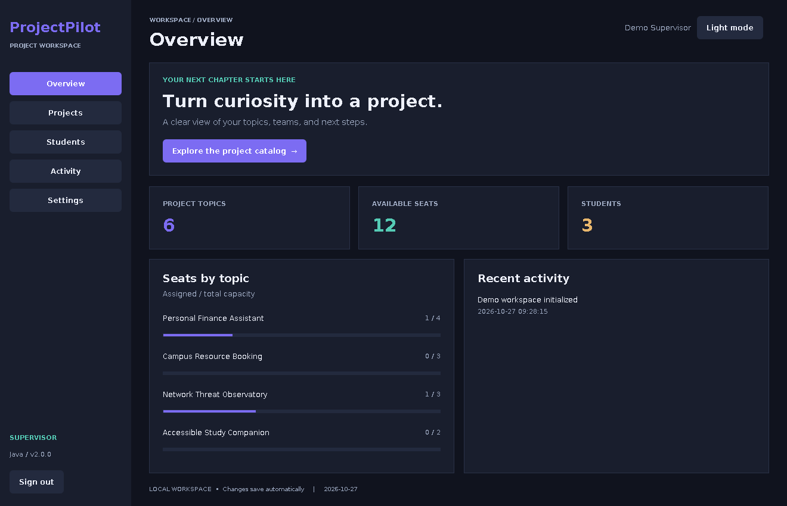
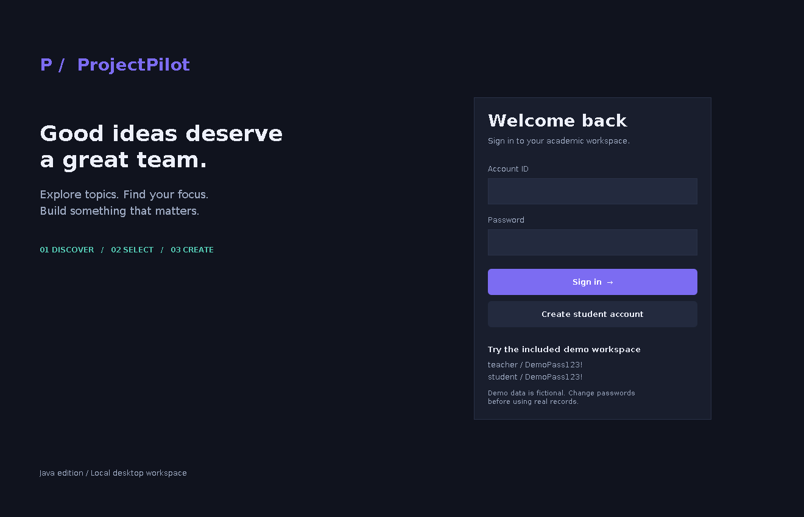
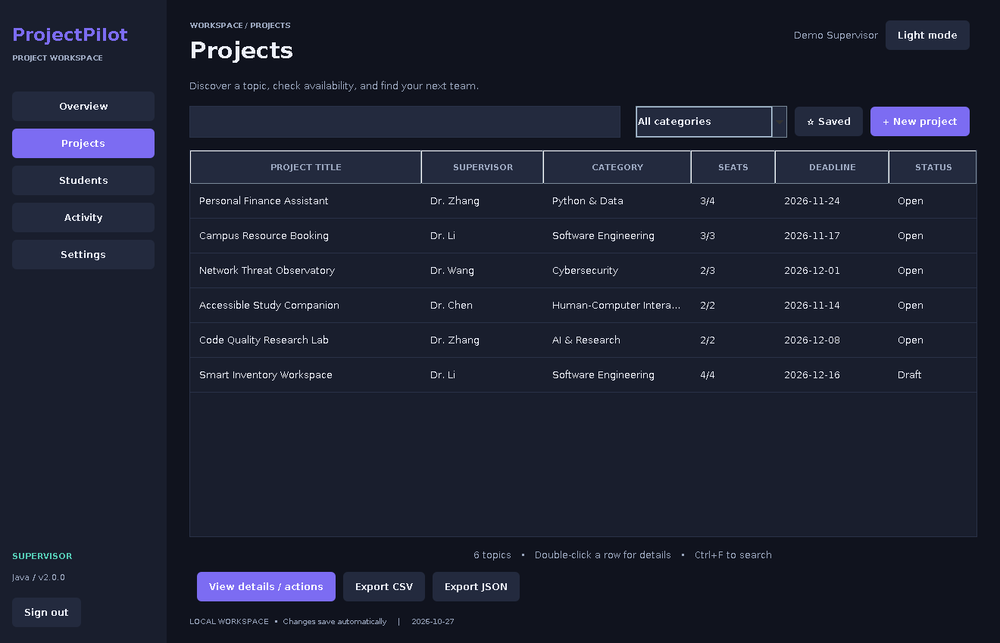
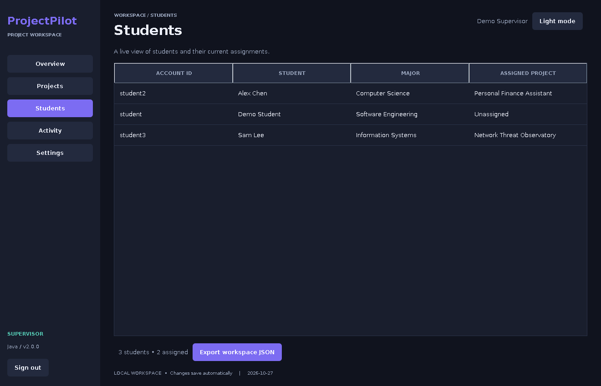
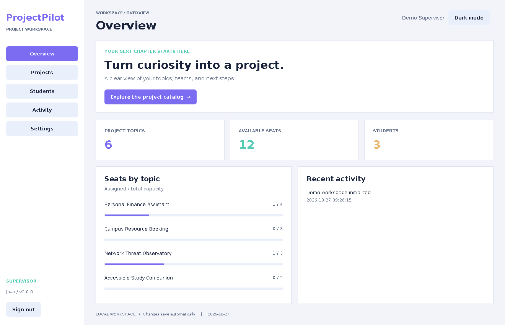
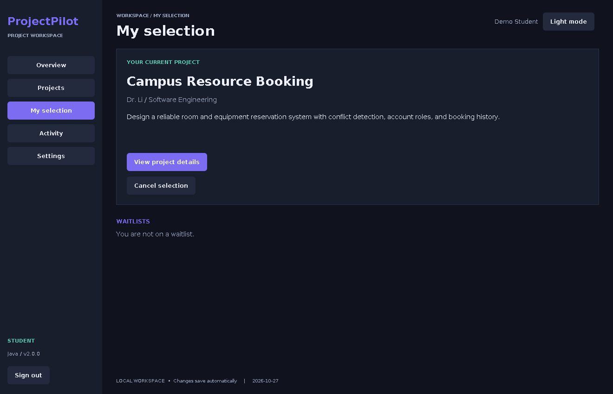
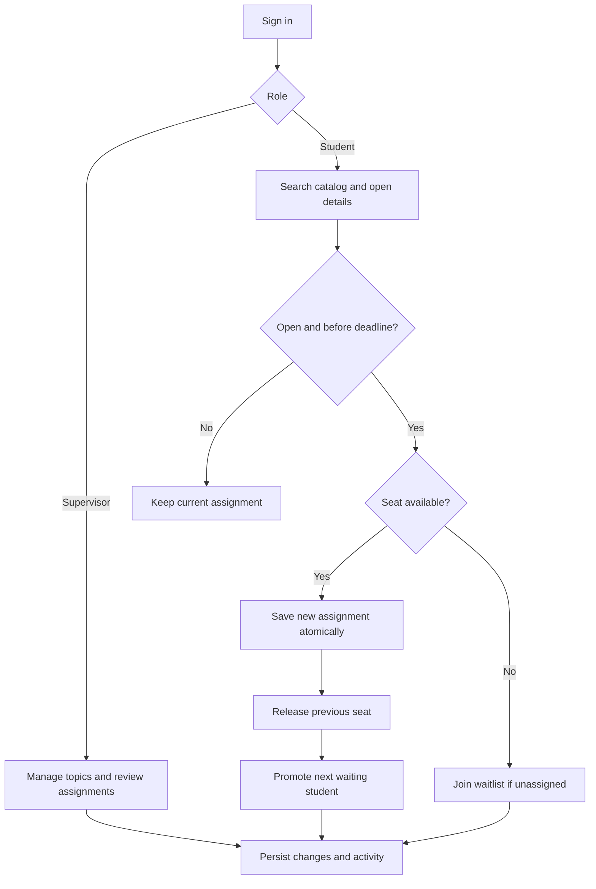

<div align="center">

# ProjectPilot

**A desktop workspace for university project-topic selection and supervision.**




</div>

## Overview

ProjectPilot is an offline Java desktop application for managing final-year and course project topics. Supervisors publish topics and monitor assignments. Students browse the catalog, save favorites, select a project, or join a waitlist when a topic is full. All data is stored locally and saved automatically. No database server or network connection is required.

Version 2.0 is a complete rewrite of the earlier **ProjectSelectionManager** (Java Swing + MySQL). It replaces the MySQL dependency with an atomic local JSON store and adds individual accounts, waitlists, a dashboard and exports.

## Features

| Area | Capabilities |
| --- | --- |
| **Interface** | Sidebar navigation, dark and light themes, resizable windows, keyboard shortcuts (`Ctrl+F` search, `F5` refresh) |
| **Discovery** | Live search across title, supervisor, category and description; category filters; saved-topic filter; sortable tables |
| **Accounts** | Student self-registration, individual sign-in, password changes, supervisor and student roles |
| **Projects** | Create, edit and delete topics with description, category, deadline, capacity and Draft / Open / Closed status |
| **Selection** | One active project per student, atomic switching, capacity derived from current assignments |
| **Waitlists** | FIFO queue per full topic, with automatic assignment when a seat opens |
| **Dashboard** | Topic and seat counts, occupancy per topic, recent activity |
| **Reporting** | Supervisor assignment view, role-scoped activity timeline |
| **Export & backup** | Project catalog as CSV; projects, permitted student records and activity as JSON; supervisor workspace backups |

## Screenshots

| Sign in | Supervisor overview |
| :---: | :---: |
|  |  |
| **Project catalog** | **Student assignments** |
|  |  |
| **Light theme** | **Student selection** |
|  |  |

Screenshots show the running application with fictional demo data. Native fonts and controls vary slightly between Windows, macOS and Linux.

## Getting started

### Requirements

- Java 17 or newer, with desktop (AWT/Swing) support
- A full JDK 17+ only if you want to rebuild or run the tests
- No Maven, Gradle, MySQL or internet connection required

### Run

**Windows:** double-click `START-WINDOWS.bat`, or run:

```powershell
java -jar dist/projectpilot.jar
```

**Linux / macOS:**

```bash
sh start.sh
```

Data is stored in `data/` next to the project by default. To use another location:

```bash
java -jar dist/projectpilot.jar --data-dir /path/to/workspace
```

### Demo accounts

A fictional demo workspace is created on first launch.

| Role | Account ID | Password |
| --- | --- | --- |
| Supervisor | `teacher` | `DemoPass123!` |
| Student | `student` | `DemoPass123!` |
| Student (pre-assigned) | `student2` | `DemoPass123!` |
| Student (pre-assigned) | `student3` | `DemoPass123!` |

Change these passwords before entering real records.

## Usage

1. Sign in as `teacher` to explore **Overview**, **Projects**, **Students**, **Activity** and **Settings**.
2. Go to **Projects → New project** and fill in title, supervisor, category, description, capacity, deadline (`YYYY-MM-DD`) and status.
3. Sign in as a student, search the catalog, open a topic and choose **Select / switch**.
4. Review or cancel the assignment under **My selection**.
5. For a full topic, choose **Join waitlist**. The first eligible student is assigned automatically when a seat opens.

### Selection rules

- Each student holds at most one active assignment. Account IDs are case-insensitive.
- Capacity is the total number of seats; remaining seats are calculated from active assignments.
- Only **Open** topics whose deadline has not passed accept selections and waitlist requests.
- A failed switch never cancels the student's current assignment.
- A topic cannot shrink below its assigned count, and an assigned topic cannot return to Draft.
- Closing or expiring a topic blocks new selections but keeps existing assignments.
- Cancelling, switching away or increasing capacity triggers FIFO promotion from the waitlist.
- Deleting a topic releases its students and removes related favorites and waitlist entries.



## Architecture

| Layer | File | Responsibility |
| --- | --- | --- |
| Entry point | `src/app/Main.java` | Creates the service and window on the Swing event thread |
| Presentation | `src/app/WorkspaceUI.java` | Pages, forms, tables, dialogs, search and themes |
| Business logic | `src/app/Service.java` | Authentication, validation, role checks, assignments, waitlists, exports |
| Persistence | `src/app/Store.java` | Process lock, JSON load, atomic save, corruption handling |
| Data model | `src/app/Models.java` | Users, projects, assignments, favorites, waitlist, activity |
| Configuration | `src/app/Config.java` | Product name, accent color, developer details |
| Build | `tools/Build.java` | Dependency-free compilation, executable JAR packaging, test runner |
| Seed data | `resources/seed.json` | Demo topics with deadlines relative to first launch |

### Persistence and security

- The full workspace lives in `data/workspace.json`. Writes snapshot in-memory state, validate, then save through a temporary file and an atomic replace; a failed write restores the snapshot.
- `data/workspace.lock` holds an OS-level lock so a second instance cannot overwrite the same workspace.
- Malformed JSON is never overwritten on startup; restore from a backup instead.
- Passwords use PBKDF2-HMAC-SHA256 with a random 16-byte salt and 210,000 iterations.
- CSV exports escape formula prefixes, and user exports never include password hashes.

### Project structure

```text
ProjectPilot/
├── src/app/            Application source
├── tests/              Service regression suite and UI smoke test
├── tools/Build.java    Build, package and test runner
├── resources/          Demo seed data
├── lib/                Gson 2.11.0
├── dist/               Prebuilt executable JAR
├── docs/               Screenshots, testing record, legacy mapping
├── START-WINDOWS.bat   BUILD-WINDOWS.bat   RUN-TESTS.bat
└── start.sh            build.sh
```

## Building from source

```bash
java tools/Build.java              # compile and package dist/projectpilot.jar
java tools/Build.java --test       # build and run the regression suite
java tools/Build.java --screenshots  # regenerate UI screenshots (needs a display)
```

On Windows, `BUILD-WINDOWS.bat` and `RUN-TESTS.bat` do the same.

To open the project in IntelliJ IDEA, set the SDK to JDK 17+, add `lib/gson-2.11.0.jar` as a library, mark `src` as Sources and `resources` as Resources, and run `app.Main`.

## Testing

The regression suite runs **33 checks** covering account validation, password changes, role restrictions, rollback on failed switches, capacity rules, waitlist promotion, export privacy, CSV escaping, deletion, backups, process locking, persistence across restarts and preservation of corrupted data. See [docs/TESTING.md](docs/TESTING.md).

## Backup and restore

- **Backup:** sign in as supervisor → **Settings → Back up workspace**.
- **Restore:** close the app, then replace `data/workspace.json` with a backup file and relaunch.
- **Reset:** close the app and move the `data/` directory aside; a fresh demo workspace is created on next launch.

## Troubleshooting

| Symptom | Fix |
| --- | --- |
| `java` is not recognized | Install Java 17+ and add its `bin` folder to `PATH` |
| `UnsupportedClassVersionError` | Upgrade to Java 17 or newer |
| `HeadlessException` | Use a desktop Java runtime on a graphical session |
| "Workspace is already open" | Close the other instance using the same data directory |
| Selection fails although seats show | Check the topic's status and deadline, then press `F5` |

## Limitations

ProjectPilot is a single-computer, offline application. It has no email verification, password-reset service or multi-device sync, and the workspace file is not encrypted. Protect the data directory and backups accordingly.

## Migrating from ProjectSelectionManager

Version 1.0 used MySQL. Its data is not imported automatically, because the old `remaining_team_members` field stores remaining seats rather than total capacity. See [docs/LEGACY-MAPPING.md](docs/LEGACY-MAPPING.md) for the field mapping.

## Third-party software

Gson 2.11.0 is bundled under the Apache License 2.0. See [THIRD_PARTY_NOTICES.md](THIRD_PARTY_NOTICES.md) and [GSON-LICENSE.txt](GSON-LICENSE.txt).

## Author

**Meazbah Mehedi** · [GitHub](https://github.com/MeazbahMehedi)
